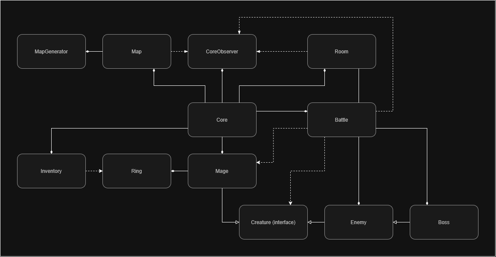
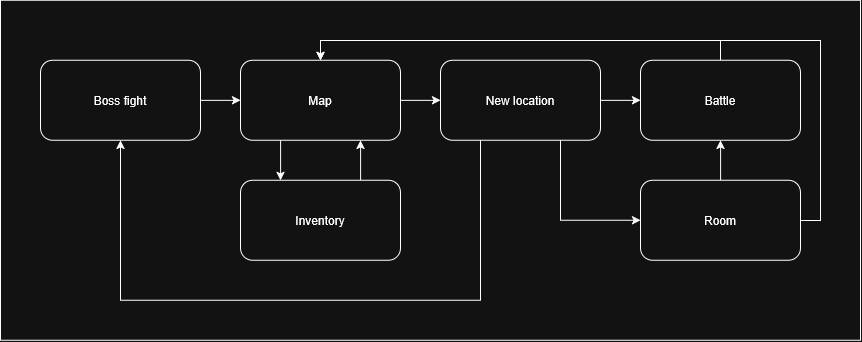
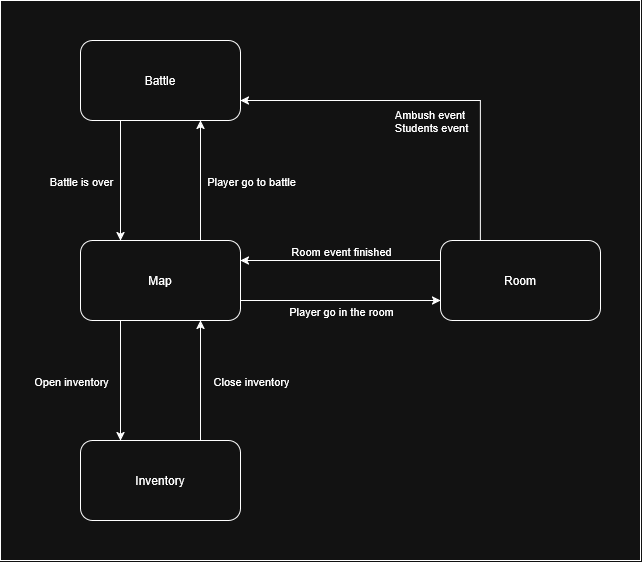

This is self-learning project on c++ - game about the Last Mage and his attempt to destroy the Mage Slayers once and for all
It has gameplay core and UI separated, currently only console UI but plans include adding another UI on SFML
Game also has magic system with elements, status effects and element combination in powerful spells

### Classes UML

### Activities UML

### Core states UML

### Math models
AttackDamage = (baseDamage + random(maxAdditionalDamage)) * (1 - frost)

- baseDamage, maxAdditionalDamage - character parameters
- frost - parameter of character that decrease damage

TakenDamage = incomingDamage * defence
- defence - character parameter
